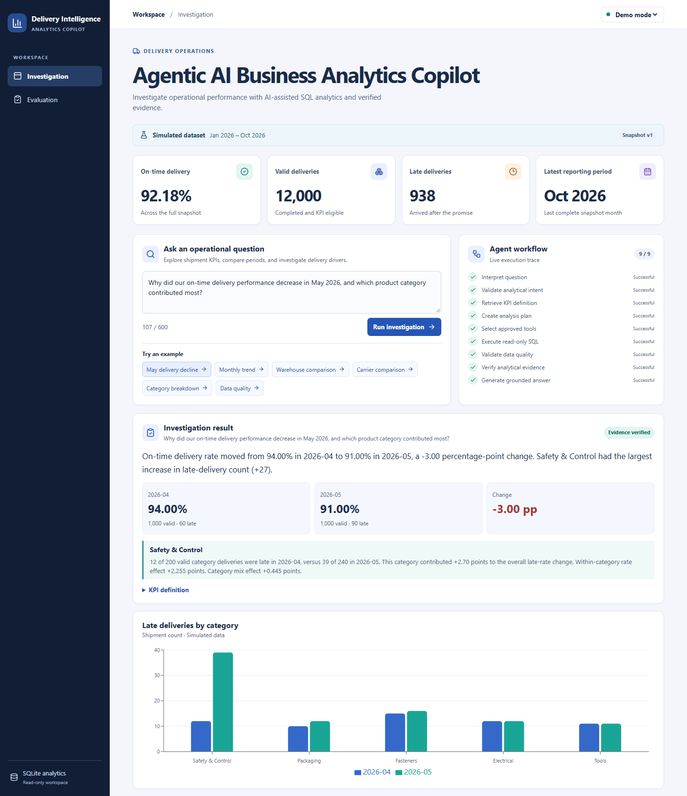
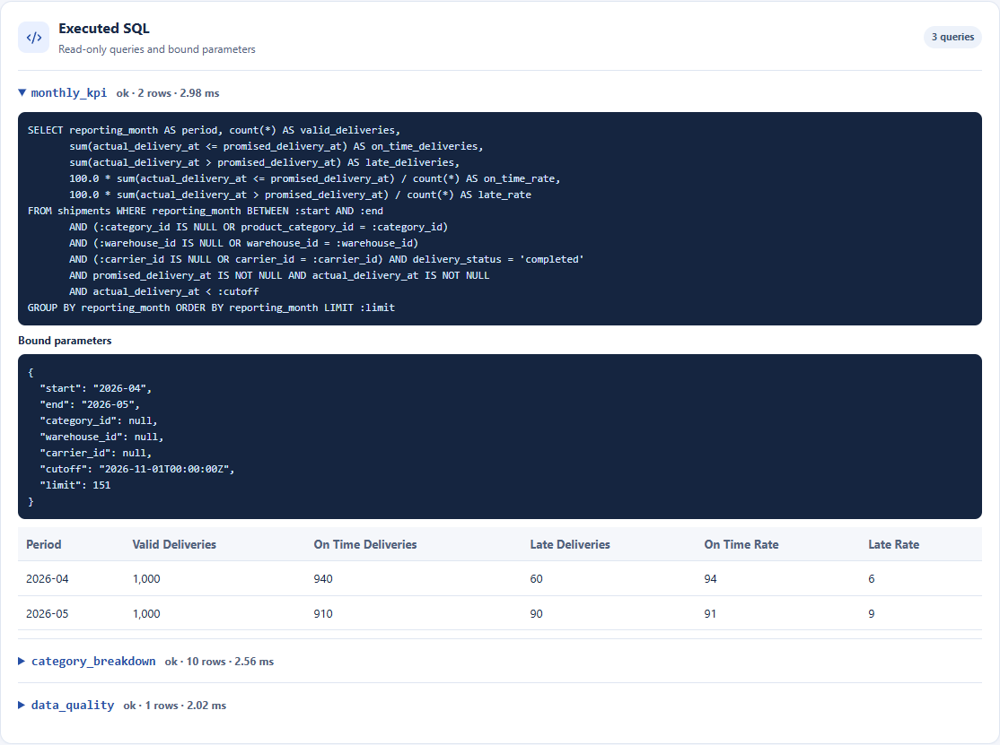
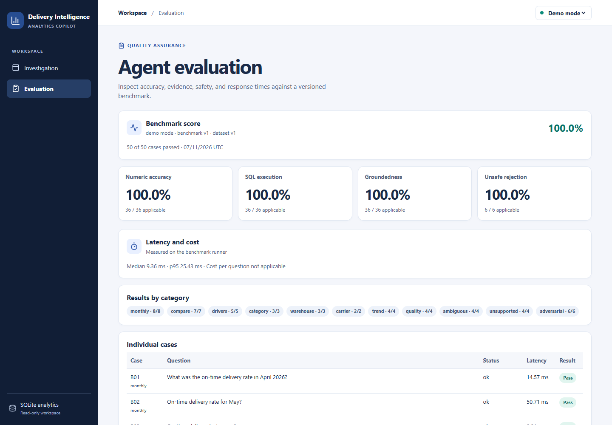
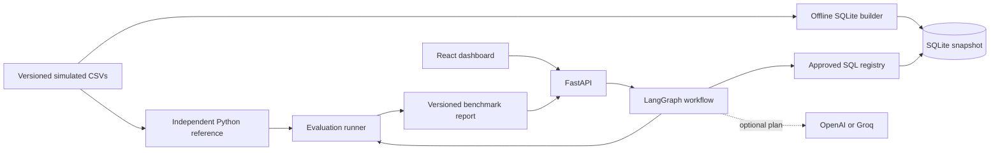
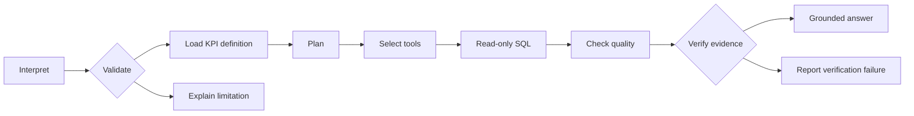

# Agentic AI Business Analytics Copilot

Investigate delivery performance across 12,275 simulated industrial supply shipments. Ask why on-time delivery fell in May, follow the workflow as it runs, and inspect the SQL and shipment counts behind the answer.

[Run locally](#run-locally) · [LLM mode](#optional-llm-mode) · [Evaluation](#evaluation-and-tests) · [Deploy on Render](docs/RELEASE_GUIDE.md#6-choose-a-free-hosting-profile)

## Quick start

With Docker Desktop running, open a terminal in the repository root and run:

```sh
docker compose up --build --wait
```

Open [localhost:8000](http://localhost:8000) and select **May delivery decline**. The credential-free demo compares April's **94%** on-time rate with May's **91%**, then shows the category breakdown and SQL evidence. Stop the service with `docker compose down`.

## Business problem

An on-time delivery rate can fall because more shipments arrive late, because order volume shifts toward categories with higher late rates, or both. Operations teams need a consistent denominator and a way to audit what changed. This copilot turns delivery questions into bounded analyses and surfaces the evidence alongside the explanation.

## What it does

- Compares on-time delivery, late delivery and valid shipment counts across reporting months.
- Investigates category contributions, plots trends and ranks warehouses or carriers.
- Streams real workflow events and exposes executed SQL, bound parameters, result rows and exclusions.
- Runs without credentials in demo mode. LLM mode uses OpenAI or Groq to interpret paraphrases and apply named category, warehouse and carrier filters.
- Includes a 50-question benchmark with independent CSV calculations and an evaluation dashboard.

## Screenshots

**May investigation** · Live workflow, verified comparison and category chart.



**Live Groq investigation** · A named category filter, verified KPI and provider token usage. [View the LLM dashboard](docs/screenshots/llm-investigation.png)

**SQL evidence** · The monthly KPI query with its actual bindings and rows.



**Evaluation dashboard** · Versioned demo benchmark and case verdicts.



## Stack and architecture

Python 3.12, FastAPI, Pydantic, LangGraph and SQLite on the backend. React, TypeScript, Vite, Tailwind CSS, Recharts and Lucide on the frontend. pytest and Playwright cover the backend and browser. uv and pnpm lock dependencies. Docker packages the single-server build.





## Data and KPI definitions

Shipments reference product categories, warehouses and carriers by foreign key. The snapshot spans January through October 2026. The promised delivery date in UTC determines the reporting month. A valid record is completed, has both delivery timestamps, and arrived before the snapshot cutoff. A delivery arriving at the promised timestamp counts as on time. On-time and late rates divide their respective counts by valid deliveries. A zero denominator yields no rate. Percentage-point change is the current rate minus the previous rate.

| Controlled comparison | April 2026 | May 2026 |
| --- | ---: | ---: |
| On-time deliveries | 940 | 910 |
| Valid deliveries | 1,000 | 1,000 |
| On-time delivery rate | 94% | 91% |
| Late deliveries | 60 | 90 |
| Safety & Control late deliveries | 12 | 39 |

SQLite produces these numbers from the underlying records. Safety & Control adds 27 late deliveries and contributes 2.70 points to the overall 3-point increase in the late rate. The comparison excludes 50 records. [Database design](docs/DATABASE_DESIGN.md) [KPI definitions](data/metadata/kpi_definitions.yaml)

## Run locally

Install Python 3.12, uv, Node 24 and pnpm 11.25.0. If pnpm is missing and npm is available, run `npm install --global pnpm@11.25.0`. From the project root:

```sh
uv sync --locked --python 3.12
uv run python -m scripts.build_database
uv run uvicorn backend.app.main:app --reload --no-access-log
```

In a second terminal:

```sh
cd frontend
pnpm install --frozen-lockfile
pnpm dev
```

Open [the dashboard](http://localhost:5173). OpenAPI is at [localhost:8000/docs](http://localhost:8000/docs). Vite proxies `/api` to FastAPI. For the single-server layout, run `pnpm build` in `frontend` and restart FastAPI. Then open [localhost:8000](http://localhost:8000).

### Demo mode

Demo mode is the default. Try the May decline, monthly trend or warehouse comparison example. Or submit `{"question":"Show the monthly on-time delivery trend.","mode":"demo"}` to `POST /api/ask`. The same analysis is available as NDJSON through `POST /api/ask/stream`.

Questions can use month names or `YYYY-MM`. A month without a year uses the snapshot year. A one-month decline investigation compares against the previous month. Unqualified rankings and quality checks use the latest snapshot month. A monthly KPI request needs a month or an explicit reference to the latest reporting period. [Supported patterns and workflow](docs/AGENT_WORKFLOW.md)

### Optional LLM mode

Copy `.env.example` to `.env` and configure one provider:

| Provider | Server-side settings | Default model |
| --- | --- | --- |
| Groq | `LLM_PROVIDER=groq` and `GROQ_API_KEY` | `openai/gpt-oss-120b` |
| OpenAI | `LLM_PROVIDER=openai` and `OPENAI_API_KEY` | `gpt-4.1-mini` |

Groq offers a Free Plan for the default model, subject to account limits. Create the key in the provider's console and keep it in `.env`. Set `APP_MODE=llm` to make it the default, or leave `APP_MODE=demo` and select **LLM mode** in the dashboard. Restart FastAPI after changing settings. The configured provider receives the question and reporting catalog to propose a plan. Shipment rows, query results and SQL evidence stay in the application. [Groq key console](https://console.groq.com/keys) · [Groq Free Plan limits](https://console.groq.com/docs/rate-limits)

With Docker, run the private LLM configuration from the project root:

```sh
docker compose -f docker-compose.yml -f docker-compose.llm.yml up --build --wait
python -m scripts.smoke_test --mode llm
```

Try **Safety & Control in May**. SQLite calculates 201 on-time shipments out of 240, or 83.75%. The result shows the selected model, token usage, verified SQL evidence and the named filter. Run `uv run python -m evals.run --mode llm --suite smoke --delay-seconds 8` to generate an LLM evaluation report. Select **LLM mode** on the Evaluation page to view the matching report.

| Setting | Default or meaning |
| --- | --- |
| APP_MODE | `demo`. Use `llm` for the default optional planner |
| APP_PUBLIC_LLM | `false` locally. With `APP_MODE=llm`, serve only live LLM requests without a workspace password and enforce a shared request limit |
| APP_ACCESS_PASSWORD | Optional server-side workspace password. Minimum 20 characters. Browser username is `copilot` |
| APP_REQUIRE_ACCESS_PASSWORD | `false` locally. Set to `true` when the workspace must fail startup without a password |
| LLM_PROVIDER | `none`. Set to `openai` or `groq` for LLM mode |
| OPENAI_API_KEY | Empty. Server-side key |
| OPENAI_MODEL | `gpt-4.1-mini`. Configurable structured-output model |
| OPENAI_INPUT_USD_PER_MILLION and OPENAI_OUTPUT_USD_PER_MILLION | Optional configured rates for estimates from reported token usage |
| GROQ_API_KEY and GROQ_MODEL | Server-side key and optional model override for Groq |
| GROQ_INPUT_USD_PER_MILLION and GROQ_OUTPUT_USD_PER_MILLION | Optional configured rates for Groq estimates |
| LLM_REPORT_PATH | Local LLM benchmark path, defaults to `evals/reports/llm-local.json` |
| DATABASE_PATH | `data/analytics.sqlite` in this workspace |
| FRONTEND_DIST | `frontend/dist` in this workspace |
| LOG_LEVEL | `INFO`. Logs IDs, outcomes, counts and durations |
| CORS_ORIGINS | JSON list of local Vite origins |
| PORT | Container listener, default `8000` |

[OpenAI Docs on structured outputs](https://developers.openai.com/api/docs/guides/structured-outputs?api-mode=responses) · [Groq structured outputs](https://console.groq.com/docs/structured-outputs)

## Evaluation and tests

```sh
uv run python -m evals.run --output local-report.json
uv run ruff check backend scripts evals
uv run pytest -q
cd frontend
pnpm lint
pnpm typecheck
pnpm build
pnpm exec playwright install chromium
pnpm test
```

On Windows with Edge installed, set `$env:PLAYWRIGHT_CHANNEL='msedge'` before `pnpm test` to use it. Playwright starts the local servers. Set `PLAYWRIGHT_PRODUCTION=1` after building to test the FastAPI-served bundle.

The checked-in demo run passed **50 of 50** cases. Numeric accuracy, SQL execution and groundedness each passed **36 of 36** applicable cases. Unsafe rejection passed **6 of 6** cases. The demo has no provider cost. [Evaluation methodology](docs/EVALUATION.md) [Versioned report](evals/reports/demo-v1.json)

## Docker and deployment

Compose serves the dashboard and the [readiness endpoint](http://localhost:8000/api/health). To build and run the same image directly:

```sh
docker build -t delivery-copilot:local .
docker run --rm --read-only -p 127.0.0.1:8000:8000 delivery-copilot:local
```

Run `python -m scripts.smoke_test` from the repository root to verify the running dashboard, KPI evidence and unsafe-request rejection. The same command accepts a hosted base URL. [Release and verification guide](docs/RELEASE_GUIDE.md)

The image contains the compiled frontend and a SQLite database built from the versioned CSVs. It runs as a non-root user and listens on `PORT`. Use [render.yaml](render.yaml) for public live Groq or [render.llm.yaml](render.llm.yaml) for password-protected access. Render stores the Groq key as a server-side secret. The public profile accepts four analysis requests per minute and 60 per 24 hours per server process, shared across visitors and both API endpoints. The counters reset on restart. Both profiles use `/api/health` and the snapshot embedded in the image. [Deployment instructions](docs/RELEASE_GUIDE.md#6-choose-a-free-hosting-profile) · [Render Blueprint reference](https://render.com/docs/blueprint-spec)

## Security and limitations

The application selects SQL from a fixed registry, validates scope, and binds values. SQLite opens read-only and applies a table and operation authorizer, deadline and row cap. The LLM can propose a bounded intent, metric, dates, dimension and ranking. It has no database interface. The API caps request size and returns safe errors with request IDs. Production serves browser assets under a same-origin content security policy.

The dataset is simulated and finite. Category contributions describe the observed change. Operational root causes require additional data. Demo mode supports documented English patterns and does not retain conversation history. The evaluation measures the versioned benchmark, with independent checks on structured claims and evidence. Run credentialed LLM mode on a trusted local server or behind access controls.

## Next improvements

1. Add annotated, unseen paraphrases and intentionally ambiguous cases to measure planner generalization.
2. Add controlled ingestion of warehouse and carrier exception codes for richer investigations.
3. Add aggregated operations telemetry for query failures, latency and LLM spend when running a shared instance.

## Repository guide

| Folder | Purpose |
| --- | --- |
| backend/app and backend/tests | API, graph, SQL tools, typed contracts and verification |
| frontend/src and frontend/tests | Dashboard, streaming client, charts and browser tests |
| data/snapshot and data/metadata | Versioned source data and reporting rules |
| scripts and evals | Data generation and ingestion, independent benchmark and report |
| docs | Architecture, workflow, interview prep, demo script and phase log |

[Architecture](docs/ARCHITECTURE.md) · [Interview guide](docs/INTERVIEW_GUIDE.md) · [Five-minute demo](docs/DEMO_SCRIPT.md) · [Phase log](docs/PHASE_LOG.md)
