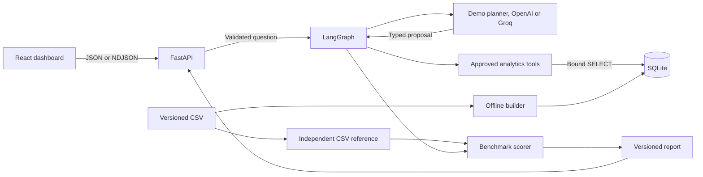

# Architecture

The build has an offline data path and an online request path. The offline generator writes fixed-seed CSVs. The builder imports them under foreign key constraints and atomically replaces the local SQLite snapshot after a successful load. The online app only opens SQLite in read-only mode.

## Runtime components

- `backend/app/main.py` applies request IDs, logging, safe errors, request bounds, local CORS and production static hosting.
- `api/routes.py` exposes v1 health, metadata, KPI, examples, analysis and evaluation routes. Clients can choose a final response or a stream of newline-delimited events.
- `agent/` coordinates interpretation, validation, definition lookup, recipe selection, execution, quality checks, verification and answer rendering.
- `services/analytics.py` owns the analytics API and category contribution arithmetic. `db/` owns fixed SQL and SQLite connection controls.
- `frontend/src/` owns question and result state, displays the actual trace, and renders server-specified chart series and evidence.
- `evals/` reads the original CSVs separately to score runtime results. Its report is an immutable asset in the Docker image.

## Design choices

SQLite simplifies snapshot distribution and deployment. It is a single local dataset. A shared production warehouse would need service identity, dataset isolation, a query budget and scoped warehouse permissions.

For count drivers, compare the category's late counts between months. For rate drivers, compare each category's late count divided by the total valid shipments of its period. The contribution is additive across categories. It reflects both within-category rate and the share of shipments in that category. The app splits these effects with a symmetric average of the two periods.

The server renders narrative text after verifying returned rows. This gives consistent outputs across planners. A future narrative model would need additional grounding and claim-level evaluation.

FastAPI serves compiled Vite assets in production. A multi-stage image avoids carrying the Node toolchain into runtime. The Docker build creates a read-only SQLite file from versioned source data, so local and hosted runs use the same inputs.
